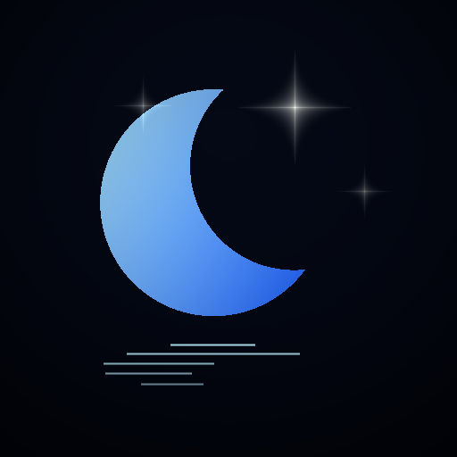
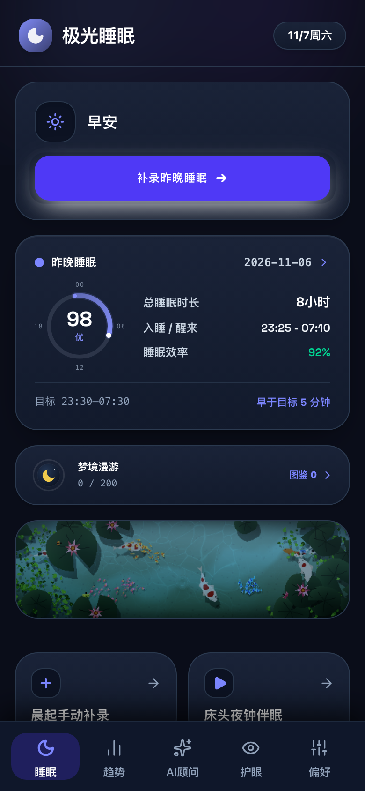
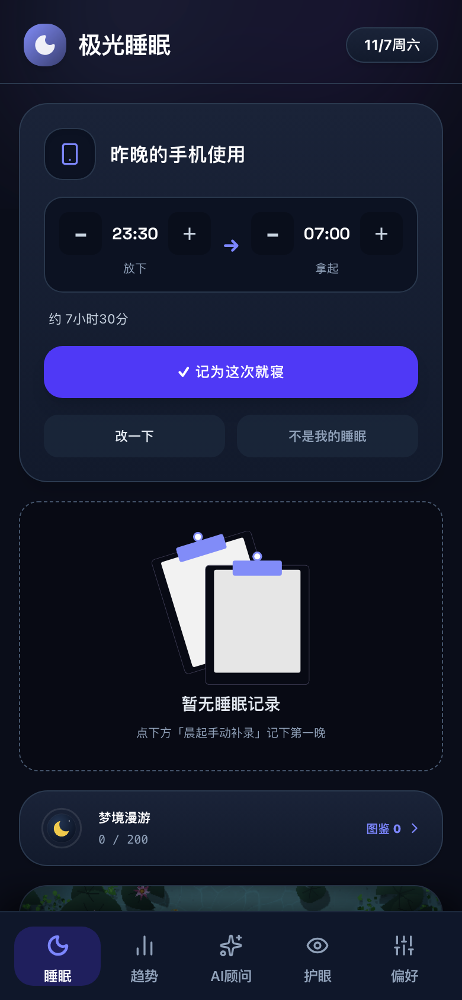
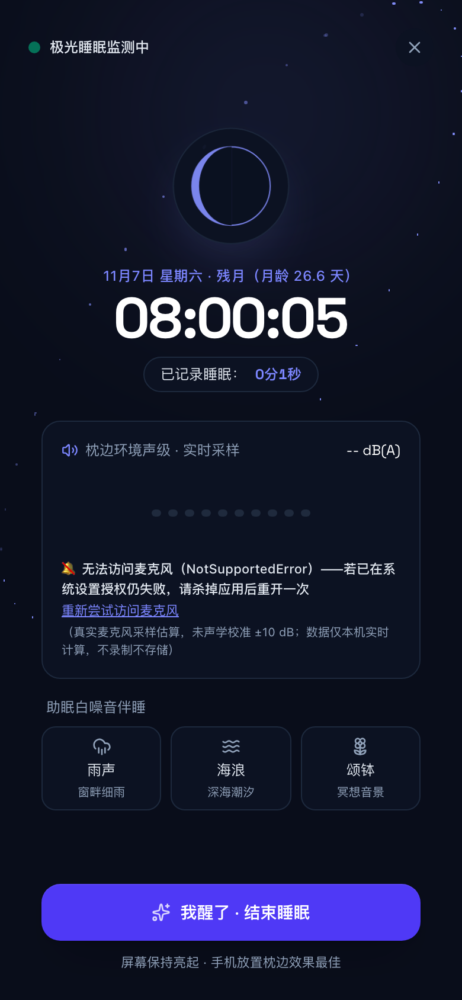
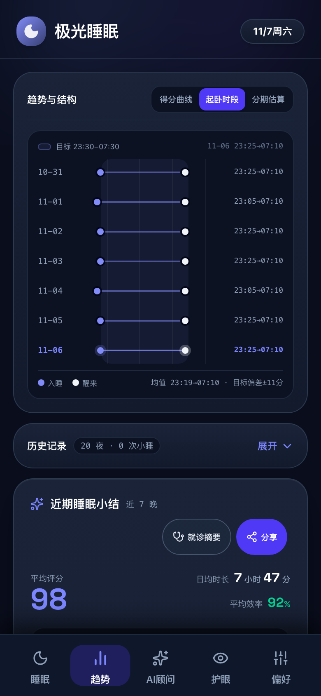
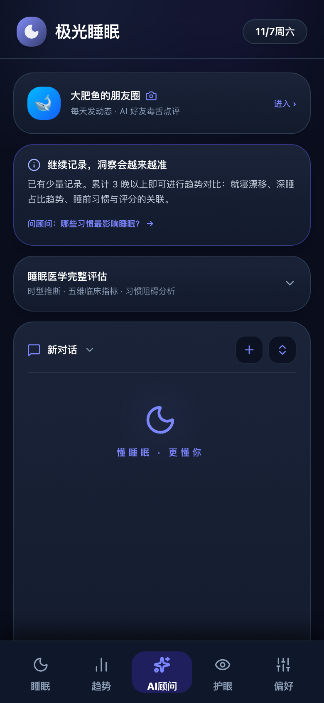
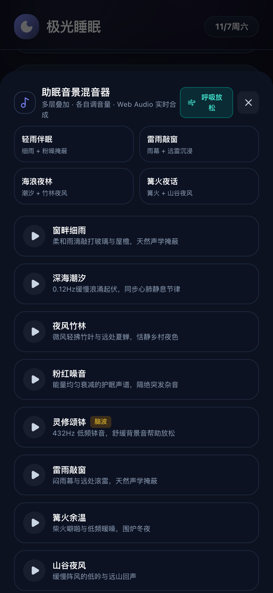
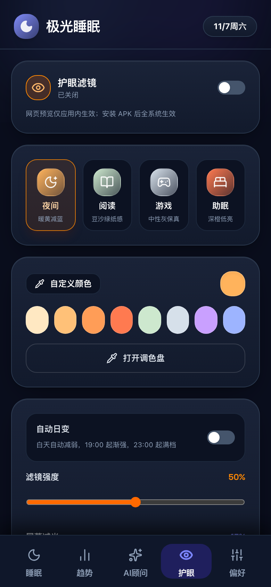
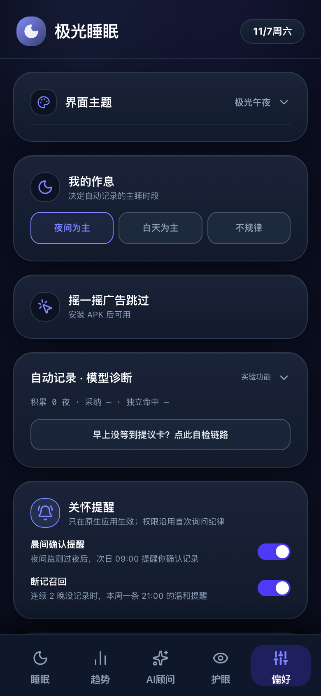
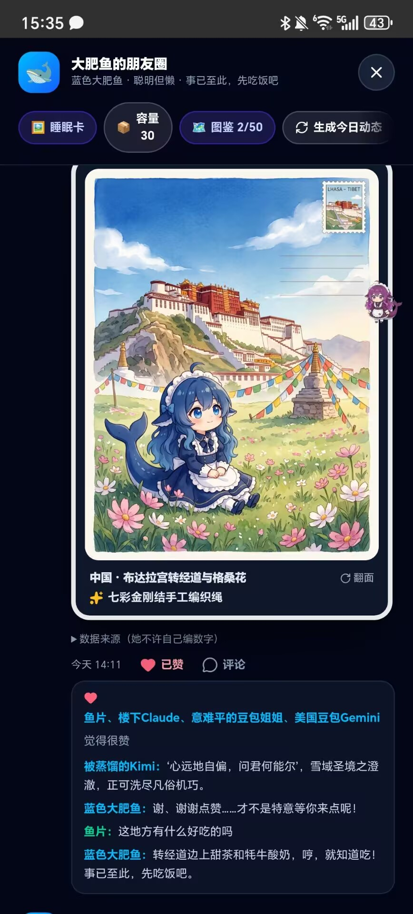

<div align="center">



# SomnaCare · 极光睡眠

**Know your sleep. And yourself.**

A 100% offline-first Android sleep tracker & insights app — logging that takes 10 seconds a night, insights built only on real data, and a whale-girl companion who wants you to sleep early.

[](../../actions/workflows/build-apk.yml)
[](../../releases/latest)
[](#-quality--verification)
[](#-license--credits)




*Open it in the morning: last night's score ring · duration · deviation from your schedule · a koi pond that lives on your real sleep*

**[📥 Install](#-install) · [🚀 First night](#-quick-start-your-first-night) · [❓ FAQ](#-faq) · [🛠 Build from source](#️-run--build-from-source)**

</div>

---

**English** | [简体中文](README.md)

## 📖 What is this

**SomnaCare** turns "how did I sleep last night?" into a 10-second ritual, then turns every recorded night into insights you can actually read.

It is built on three promises:

- **🔌 Offline-first** — all sleep data lives on your phone only. No account, no upload, no background phoning home. The network is touched only when *you* tap: checking updates, downloading an on-device AI model, or chatting with the AI.
- **📏 Data honesty** — no actigraphy or EEG sensor, so no pretending to "measure" deep sleep or REM. All sleep stages are model estimates and labeled as such in the UI; nights with zero data produce no fake reports; the AI is forbidden from inventing numbers.
- **🔒 Privacy by default** — no audio ever leaves the device; exported backups have API keys stripped; ad-skipping rules run entirely locally.

## ✨ Features

| | Feature | In one line |
|---|---|---|
| 🌙 | **One-tap logging** | Start before bed, tap "I'm awake" in the morning — computed from real times, never fabricated |
| 🤖 | **Auto proposal** (optional) | Grant "Usage access" and the app infers last night's schedule from screen on/off moments — wake up, tap once to confirm |
| ⌚ | **Bedside monitor** | Full-screen dark panel with live ambient sound level + spectrum (computed locally, zero audio upload) |
| 📊 | **Trends & insights** | Bedtime/wake dumbbell chart, score curve, stage estimates, tappable month calendar, clinical summary export |
| ✨ | **AI advisor** | Local insight engine + three swappable engines (DeepSeek cloud / on-device offline model / zero-config rule engine); invented numbers get rejected wholesale |
| 🐋 | **Whale-girl companion** | A behavior system driven by time-of-day weights: tea in the afternoon, reading at dusk, nagging you to drop the phone at night; she genuinely celebrates your streaks |
| 🏝️ | **Dream Roaming** | A living koi pond + travel codex; good nights charge energy that unlocks new places |
| 👁 | **Eye care** | Global eye-comfort filter, 20-20-20 break reminders, daily screen-time report |
| 🔊 | **Sleep soundscapes** | 9 real-time synthesized sounds with multi-layer mixing + 4-7-8 breathing guide; zero audio files, works offline |
| 🚫 | **Ad skipper** (optional) | Local rules auto-tap splash/popup close buttons (rules based on the GKD subscription; accessibility service; off by default) |
| ⏰ | **Custom alarm** | Native exact alarm + 30-second fading chime, reliable while the screen is off |
| 🎨 | **Four themes** | Midnight Blue / Pure Black OLED / Amber Night / Deep Sea — the launcher icon re-tints to match |

## 📸 Screenshots

<table>
  <tr>
    <td align="center"><br><sub>Sleep · morning score ring</sub></td>
    <td align="center"><br><sub>Auto proposal · one tap to log</sub></td>
    <td align="center"><br><sub>Bedside monitor · live spectrum</sub></td>
  </tr>
  <tr>
    <td align="center"><br><sub>Trends · dumbbell chart & summary</sub></td>
    <td align="center"><br><sub>AI advisor · her social feed</sub></td>
    <td align="center"><br><sub>Soundscapes · multi-layer mixer</sub></td>
  </tr>
  <tr>
    <td align="center"><br><sub>Eye care</sub></td>
    <td align="center"><br><sub>Settings · four themes</sub></td>
    <td align="center"><br><sub>Travel postcard · AI friend comments</sub></td>
  </tr>
</table>

## 📥 Install

1. Open the [**Releases page**](../../releases/latest) and download the latest `SomnaCare-vX.X.X.apk` (no login needed);
2. Tap to install — first time requires allowing "Install unknown apps";
3. Open the app and follow the 30-second onboarding.

> - **Requirements**: Android 7.0 (API 24)+; the global eye-comfort filter is best on Android 10+.
> - **Upgrading**: install over the existing build — all sleep data and collection progress are kept (fixed release signing; versionCode increments per build).
> - **Why not on Google Play**: the permission combination this app needs (accessibility service + system overlay, etc.) doesn't fit Play policy, so it ships as a sideloaded APK via GitHub Releases only.

## 🚀 Quick Start: your first night

**Before bed (30 seconds)**

1. On the **Sleep** tab, tap **Start night monitoring** (bedside monitor) — or do nothing at all; tomorrow's auto proposal / manual entry works just as well;
2. Want the auto proposal? Tap **Enable auto recording** on the Sleep tab and grant "Usage access" (screen on/off moments only — never screen contents).

**In the morning (10 seconds)**

3. Open the app: last night's card is already waiting — check the bedtime/wake times and tap once to log it;
4. The score ring, stage structure, and schedule deviation are right there; tap the card to jump into **Trends** for curves and the month calendar.

**After that (hands off)**

- At your target bedtime, a crescent-moon animation reminds you to put the phone down (optional);
- After a few missed nights, a gentle weekly recall notification nudges you back (at most once a week, optional);
- A morning confirmation notification can arrive at 9 AM (optional).

> Every reminder and automation has its own switch in **Settings** — defaults are conservative.

## 🔒 Privacy & data honesty

- **All sleep data stays on your phone** (localStorage). No accounts, no uploads; the network is only touched on your explicit tap (update check / model download / AI chat);
- Sleep stages are **model estimates** derived from your bedtime/wake times and 90-minute ultradian cycles — the app never reads motion or EEG sensors, the UI labels estimates everywhere, and nothing here replaces polysomnography (PSG);
- **No audio ever leaves the device**: the bedside monitor computes sound levels locally, and sound events / dream notes are excluded from any AI payload;
- Cloud AI needs your own DeepSeek API key (stored locally, connects directly to the official API); skip it and use the on-device model or the built-in rule engine;
- **Credentials & endpoint URLs never enter backup files**: exported backups contain no API keys, and custom endpoint URLs don't travel with backups (prevents "backup redirection");
- **Corruption safety**: if stored data can't be parsed, the raw string is backed up first and the app starts in an empty state — never silently overwritten;
- The pet's late-night nags only read the system's interactive state; usage statistics come from aggregated screen-on events (optional permission — without it, features degrade gracefully).

## 🔐 Permissions

| Permission | Why |
|---|---|
| `SCHEDULE_EXACT_ALARM` / `USE_EXACT_ALARM` | Exact alarm wake-ups, bedtime reminders |
| `POST_NOTIFICATIONS` | Alarm sound channel / eye-care & reminder notifications |
| `WAKE_LOCK` | Keep the alarm flow alive while the screen is off |
| `RECORD_AUDIO` | Bedside monitor sound-level sampling only (tap to start, refusable, degrades honestly) |
| `RECEIVE_BOOT_COMPLETED` | Restore alarm & reminder schedules after reboot |
| `SYSTEM_ALERT_WINDOW` | Global eye-care filter / bedtime reminder overlay / pet window |
| `FOREGROUND_SERVICE(+SPECIAL_USE)` | Eye-care filter, bedtime reminder, pet, alarm foreground services |
| `PACKAGE_USAGE_STATS` (optional) | Aggregated screen-on moments for auto proposals & usage compare; without it, those features degrade gracefully |
| `INTERNET` | Only two egress paths: ① in-app update check & APK download (on tap); ② **user-initiated** AI traffic (model download / DeepSeek direct — only with a key). Sleep data never leaves the phone |
| `REQUEST_INSTALL_PACKAGES` | Hands the downloaded APK to the system installer |
| `REQUEST_IGNORE_BATTERY_OPTIMIZATIONS` | Optional battery-optimization whitelist so the accessibility service survives OEM cleanup |
| Accessibility (AdSkipService, optional, off by default) | Reads the **foreground app's view tree** to auto-tap ad close buttons; rules are local, revocable any time in system settings |

## ❓ FAQ

<details>
<summary><b>How accurate is it?</b></summary>

Bedtime/wake times are real measurements (confirmed by you, or inferred from screen on/off signals). Deep/light/REM percentages are **model estimates** based on 90-minute ultradian cycles, labeled as such throughout. Great for spotting trends and schedule regularity — not a medical device.
</details>

<details>
<summary><b>Does it drain the battery?</b></summary>
Night monitoring only samples local microphone levels (turn it off anytime). Auto recording reads system-aggregated screen events with no background polling. The pet's rendering pauses when the screen is off, when it's covered, and whenever the frame wouldn't change.
</details>

<details>
<summary><b>What about switching phones / reinstalling?</b></summary>
The **full backup** in Settings exports one JSON (records, profile, collection, social feed) and imports on a new phone as-is. Backups contain no API keys; over-the-top upgrades never lose data.
</details>

<details>
<summary><b>Does the AI cost money? Does it need internet?</b></summary>
Neither is required. The default local rule engine and the on-device model (Gemma 3 1B) are free and fully offline. If you want DeepSeek cloud answers, bring your own API key — it connects straight to the official API.
</details>

<details>
<summary><b>Is the ad skipper safe? Any misclicks?</b></summary>
Rules require explicit ad-text anchors plus strict click-target size constraints, with tapjacking protection built in. It's off by default and needs the accessibility service enabled explicitly. Everything runs on your phone; nothing is uploaded.
</details>

## 🛠 Run & build from source

```bash
git clone https://github.com/bowentown/somnacare.git
cd somnacare
npm install --legacy-peer-deps
npm run dev          # Web preview at http://localhost:3000
```

```bash
npm run verify       # Static guardrails + behavior assertions (key guards have reverse self-checks)
npm run build        # Web bundle (dist/ deployable as a PWA)
npx playwright test  # Full browser e2e regression
```

Android APK (requires Android SDK / JDK 21):

```bash
npm run build && npx cap add android && npx cap sync android
cd android && ./gradlew assembleDebug
```

> Don't want to set up a toolchain? Pushing to `main` triggers a CI build; **pushing a `v*` tag** publishes to [Releases](../../releases). APKs are built by CI with a **fixed signing key** (injected via GitHub Secrets; the repo contains no keys) — ⚠️ if the keystore is ever lost, existing installs can never be updated over. Development conventions, architecture boundaries, and how the 46 guardrails are wired live in [AGENTS.md](AGENTS.md).

## ✅ Quality & verification

This project treats its verification system as a feature in its own right:

- **46 static guardrails (650+ assertions)**: sleep-model numeric bounds, proposal gate semantics (incl. cross-midnight circular medians), backup credential stripping & field allowlists, copy discipline (no medical claims / mechanistic causality), pet behavior shape… all wired into CI, with **reverse self-checks** on key guards (feeding a broken implementation into the same assertion path must turn them red);
- **Mutation testing**: the guardrails themselves are mutation-tested — 66 known-bad code shapes, all of which must be caught by their corresponding guard for the suite to pass;
- **68 Playwright e2e tests**: five-pane rendering, gesture-driven pane sliding, the full auto-proposal pipeline (including "invented numbers get rejected"), permission take-effect, backup round-trips, calendar interaction, and a zero-uncaught-error watchdog across all panes.

## 🧱 Tech stack

- **Frontend**: React 19 + TypeScript + Vite + Tailwind CSS; Web Audio synthesized soundscapes; Recharts charts; unDraw illustrations
- **Mobile**: Capacitor 8 native shell (minSdk 24), fully automated CI builds
- **On-device AI**: wllama + Qwen3-0.6B (Web) / Google MediaPipe + Gemma 3 1B (Android; mmap loading, resumable downloads, stall watchdog, streaming)
- **Native plugins**: eye-care filter, pet behavior system (dedicated render thread), exact alarms, usage signals, home-screen widget

<details>
<summary><b>Project layout</b></summary>

```
somnacare/
├── src/
│   ├── components/        # Five-tab UI, splash/reminder animations, alarm manager, mixer, etc.
│   ├── utils/             # Sleep scoring & stage estimation, clinical rule engine, insight engine,
│   │                      # on-device LLM, proposal engine, native alarm, eye-care filter, theming
│   └── types/             # Domain models
├── plugins/cap-gemma-llm/ # Local plugin (MediaPipe Gemma, eye-care service, pet behavior system, widget)
├── plugins/cap-usage-signal/ # Usage signals (screen-on aggregation, data source for auto proposals)
├── tools/                 # Screenshot capture, icon/splash generators, GKD rule import, 46 static guardrails
├── docs/screenshots/      # README screenshots
├── tests/e2e/             # Playwright: smoke / proposal pipeline / full app flows / social feed
└── .github/workflows/     # CI: push builds the APK; v* tags publish a Release
```

</details>

## ⚠️ Disclaimer

A personal project, for learning and personal use. All sleep analysis is model-estimated and not a medical diagnosis or treatment advice — if you have a sleep disorder, please see a doctor.

## 📄 License & credits

- **Code**: [MIT](LICENSE) (see the artwork license exception section within)
- **Character artwork** (whale-girl pet sprites): **not covered by MIT** — non-commercial license, attribution required, see [`pet/NOTICE.md`](plugins/cap-gemma-llm/android/src/main/assets/pet/NOTICE.md)
- **Pond engine** (`src/pond/`): ported from [nagomi](https://github.com/msk1039/nagomi) (PolyForm Noncommercial 1.0.0), **not covered by MIT**
- **Ad rules**: based on [GKD_subscription](https://github.com/Lin-arm/GKD_subscription) (fetched at build time, security-audited)
- Charts by [Recharts](https://github.com/recharts/recharts) · Illustrations by [unDraw](https://undraw.co) · Component idioms from shadcn/ui Charts / Tremor

## 📸 Screenshot maintenance

`docs/screenshots/` is generated by [`tools/capture-screenshots.mts`](tools/capture-screenshots.mts) (web preview = the exact same WebView the APK renders, 390×844 @2x). After UI changes:

```bash
npm run dev &          # if the dev server isn't running
npx tsx tools/capture-screenshots.mts
```
