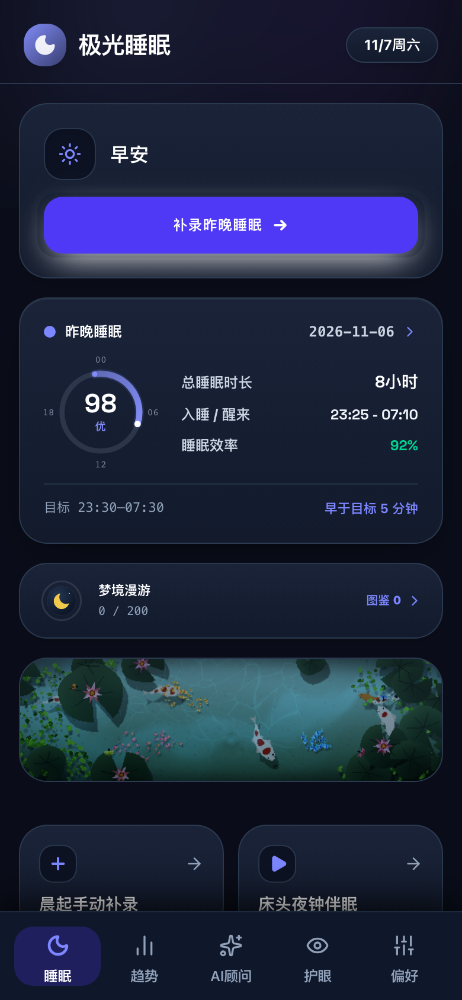
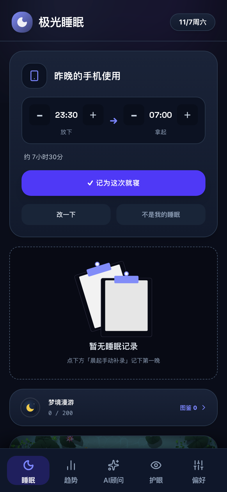
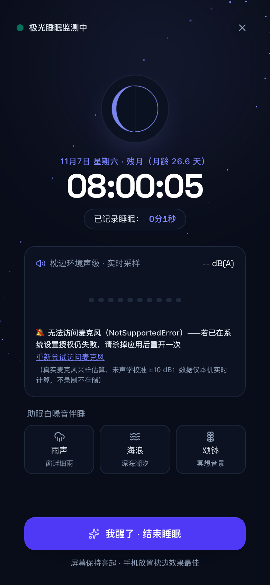
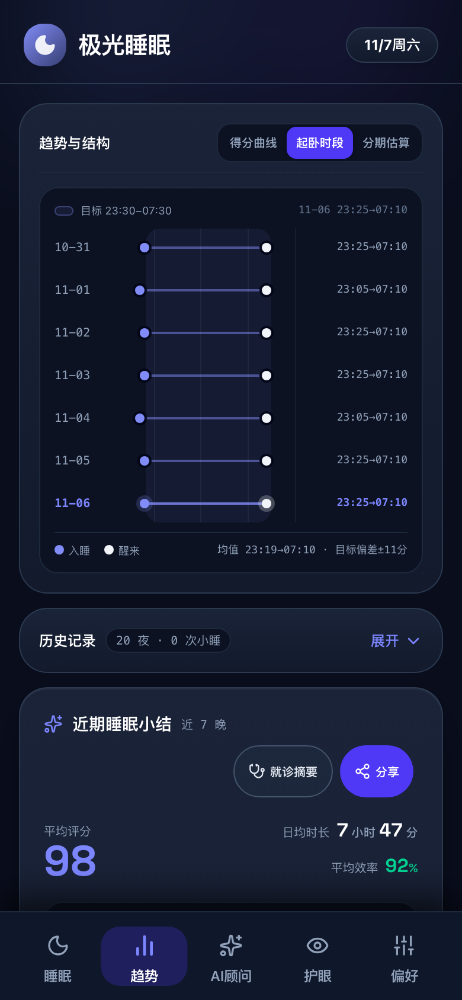
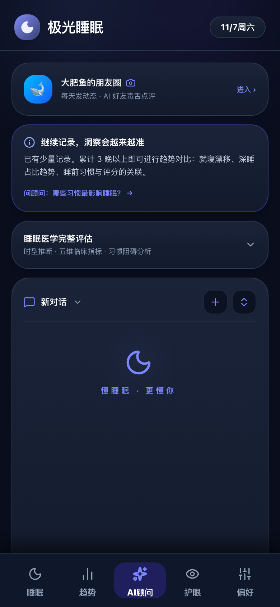
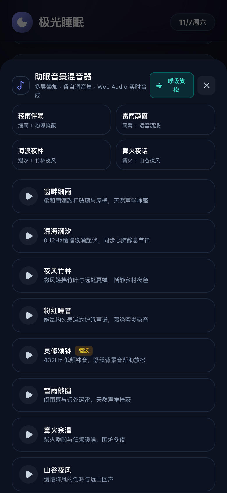
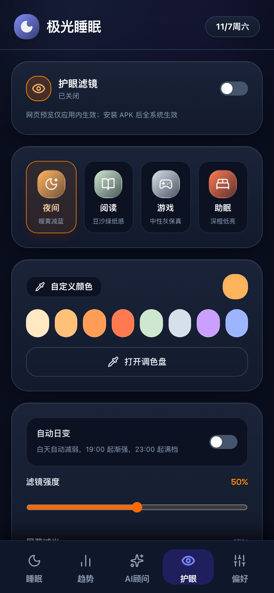
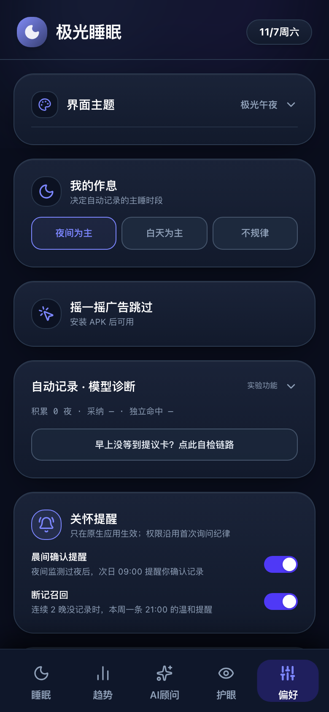
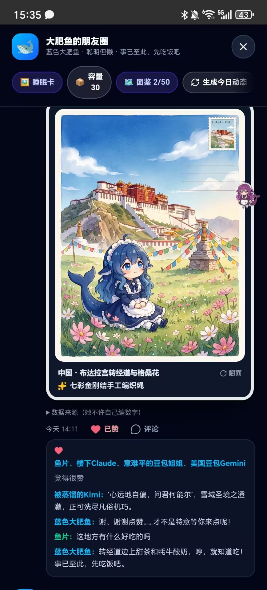

<div align="center">


# 极光睡眠 SomnaCare

**懂睡眠，更懂你。**

一款 100% 离线优先的 Android 睡眠记录与分析应用——记录零打扰，洞察只基于真实数据，一只鲸鱼娘桌宠陪你早睡。

[](../../actions/workflows/build-apk.yml)
[](../../releases/latest)
[](#-质量与验证)
[](#-许可证与致谢)




*晨间打开即见：昨晚评分环 · 时长 · 与作息目标的偏差 · 一只会看你睡眠数据的锦鲤池*

**[📥 下载安装](#-下载安装) · [🚀 快速上手](#-快速上手你的第一晚) · [❓ 常见问题](#-常见问题) · [🛠️ 构建指南](#️-从源码运行构建)**

</div>

---

## 📖 这是什么

**极光睡眠**是一件贴身的小事：把"记录昨晚睡得怎么样"压缩到 10 秒钟，再把积累的每一晚变成看得懂的洞察。

它建立在这三条承诺上：

- **🔌 离线优先** —— 所有睡眠数据只存在你的手机里。没有账号、没有上传、没有后台偷偷联网；联网只发生在你主动点击的时刻（检查更新 / 下载 AI 模型 / AI 对话）。
- **📏 数据诚实** —— 没有体动或脑波传感器，就不会假装测出了深睡和 REM。所有分期都是模型估算并在界面上明确标注；零记录的夜晚不生成假报告，AI 被禁止编造任何数字。
- **🔒 隐私默认** —— 不上传任何音频；备份文件自动剥离 API 密钥；广告跳过规则全本地运行。

## ✨ 功能一览

| | 功能 | 一句话 |
|---|---|---|
| 🌙 | **一键记录** | 睡前轻按开始、醒后点"已醒来"，按真实起止时间计算，绝无虚构拉长 |
| 🤖 | **自动提议**（可选） | 授权"使用情况访问"后，从屏幕亮灭时刻推算昨晚作息，醒来点一下确认即完成记录 |
| ⌚ | **床头夜钟伴眠** | 全屏暗色监测页，实时环境声级 + 频谱可视化（本地计算，不上传任何音频） |
| 📊 | **趋势与洞察** | 起卧时段哑铃图、得分曲线、分期估算、月历点选、就诊摘要导出 |
| ✨ | **AI 顾问** | 本地洞察引擎 + 三引擎自由切换（DeepSeek 云端 / 端侧离线模型 / 零配置规则引擎），编造数字会被整条拒收 |
| 🐋 | **鲸鱼娘桌宠** | 时段权重驱动的行为系统：午后喝茶、傍晚看书、深夜劝你放下手机；连续达标她真会庆祝 |
| 🏝️ | **梦境漫游** | 锦鲤池塘 + 旅行图鉴，记录达标攒能量解锁新地点 |
| 👁 | **护眼健康台** | 全局护眼滤镜、20-20-20 远眺提醒、用眼日报 |
| 🔊 | **助眠音景** | 9 种实时合成音效多层混音 + 4-7-8 呼吸引导，零音频文件断网可用 |
| 🚫 | **广告跳过**（可选） | 本地规则自动点击开屏/弹窗关闭按钮（参考 GKD 订阅规则，无障碍服务，默认关闭） |
| ⏰ | **自定义闹钟** | 原生精确闹钟 + 30 秒渐弱钟声，息屏可靠唤醒 |
| 🎨 | **四套主题** | 午夜蓝 / 纯黑 OLED / 琥珀暖夜 / 静谧深海，桌面图标随主题联动换色 |

## 📸 界面预览

<table>
  <tr>
    <td align="center"><br><sub>睡眠 · 晨间评分环</sub></td>
    <td align="center"><br><sub>自动提议 · 点一下完成记录</sub></td>
    <td align="center"><br><sub>床头夜钟 · 声级可视化</sub></td>
  </tr>
  <tr>
    <td align="center"><br><sub>趋势 · 起卧时段与小结</sub></td>
    <td align="center"><br><sub>AI 顾问 · 大肥鱼的朋友圈</sub></td>
    <td align="center"><br><sub>助眠音景 · 多层混音</sub></td>
  </tr>
  <tr>
    <td align="center"><br><sub>护眼健康台</sub></td>
    <td align="center"><br><sub>偏好 · 四套主题</sub></td>
    <td align="center"><br><sub>旅行明信片 · AI 好友评论</sub></td>
  </tr>
</table>

## 📥 下载安装

1. 打开 [**Releases 页面**](../../releases/latest)，下载最新的 `SomnaCare-vX.X.X.apk`（无需登录）；
2. 手机上点开安装——首次需允许「安装未知来源应用」；
3. 打开 App，跟完 30 秒首次引导即可开始使用。

> - **系统要求**：Android 7.0（API 24）及以上；护眼滤镜的全局模式建议 Android 10+。
> - **升级**：直接覆盖安装即可，睡眠数据与图鉴进度全部保留（固定 release 签名，versionCode 随构建号递增）。
> - **不上架应用商店**：本应用的权限组合（无障碍服务 + 悬浮窗等）不符合 Google Play 政策，仅通过 GitHub Release 侧载分发。

## 🚀 快速上手：你的第一晚

**睡前（30 秒）**

1. 在 **睡眠** 页按 **开始夜间监测**（床头夜钟），或什么都不做——明早用自动提议 / 手动补录也一样；
2. 想要自动提议？在 **睡眠页 → 开启自动记录** 授权"使用情况访问"（只读亮屏时刻，不读屏幕内容）。

**醒来（10 秒）**

3. 打开 App：昨晚的睡眠卡已经在等你——核对就寝/起床时刻，点一下完成记录；
4. 评分环、分期结构、与作息目标的偏差当场可见；点卡片直达 **趋势** 看曲线与月历。

**之后（交给 App）**

- 到就寝时间，弯刀月动画会提醒你放下手机（可关）；
- 连续断记几晚，会收到一条温和的召回提醒（每周至多一次，可关）；
- 醒来后 9 点有一条"确认昨晚记录"的晨间提醒（可关）。

> 全部提醒与自动化都在 **偏好** 页有独立开关，默认保守。

## 🔒 隐私与数据诚实

- **所有睡眠数据只存手机本地**（localStorage），无账号系统、无上传；联网仅发生在你主动点击时（更新检查 / 模型下载 / AI 对话）；
- 睡眠分期是**基于作息起止点与 90 分钟超昼夜节律的模型推演值**——App 未读取体动/脑波传感器，界面均标注"模型估算，非医疗诊断"，不能替代多导睡眠监测（PSG）；
- **不上传任何音频**：床头监测的声级在本地计算，AI 载荷里也排除了声事件与梦境笔记；
- 云端 AI 需要你自己的 DeepSeek API Key（仅本地存储、直连官方接口）；不填也能用端侧模型或规则引擎兜底；
- **凭据与端点地址不进备份文件**：导出的备份里没有 API 密钥，端点地址也不随备份迁移（防"备份改道"）；
- **损坏自护**：存储数据异常时会先备份原始数据再进入空态，绝不无声覆盖；
- 桌宠"深夜劝睡"只读系统屏幕亮灭状态（`isInteractive`）；使用行为统计只来自系统聚合的亮屏事件（需主动授权，不授权则优雅降级）。

## 🔐 权限用途

| 权限 | 用途 |
|---|---|
| `SCHEDULE_EXACT_ALARM` / `USE_EXACT_ALARM` | 闹钟精确唤醒、到点提醒 |
| `POST_NOTIFICATIONS` | 闹钟铃声通道 / 护眼与提醒常驻通知 |
| `WAKE_LOCK` | 息屏后维持响铃流程 |
| `RECORD_AUDIO` | 仅床头监测页声级采样（点按开启、可拒绝、诚实降级） |
| `RECEIVE_BOOT_COMPLETED` | 重启后自动恢复闹钟与提醒调度 |
| `SYSTEM_ALERT_WINDOW` | 护眼全局滤镜 / 到点提醒悬浮动画 / 桌宠悬浮窗 |
| `FOREGROUND_SERVICE(+SPECIAL_USE)` | 护眼滤镜、就寝提醒、桌宠、响铃前台服务 |
| `PACKAGE_USAGE_STATS`（可选授权） | 自动记录提议与使用对照的亮屏时刻聚合；不授权则对应功能优雅降级 |
| `INTERNET` | 仅两类出口：① 应用内更新检查与下载 APK（点击时）；② 【用户主动】的 AI 出口（模型下载 / DeepSeek 直连，填 Key 才启用）。睡眠数据不出网 |
| `REQUEST_INSTALL_PACKAGES` | 下载完成后调起系统安装器 |
| `REQUEST_IGNORE_BATTERY_OPTIMIZATIONS` | 可选加入电池优化白名单，降低无障碍服务被系统清理的概率 |
| 无障碍服务（AdSkipService，可选启用，默认关闭） | 读【前台应用的界面树】以自动点击广告关闭按钮；规则全本地、可随时在系统设置关闭 |

## ❓ 常见问题

<details>
<summary><b>睡眠数据准确吗？</b></summary>

就寝/起床时刻是真实测量的（你确认的，或亮灭屏信号推算的）；深睡/浅睡/REM 占比是按 90 分钟昼夜节律模型的**估算值**，界面全程标注"模型估算"。它适合观察趋势与作息规律，不能替代医疗检测。
</details>

<details>
<summary><b>会耗电吗？</b></summary>
夜间监测只做本地麦克风声级采样（可随时关闭）；自动记录读的是系统聚合的亮屏事件，不驻留后台轮询；桌宠动画在熄屏、被遮挡、画面无变化时全部自动暂停。
</details>

<details>
<summary><b>换手机 / 重装，数据怎么办？</b></summary>
偏好页的<b>全量备份</b>一键导出 JSON（含记录/档案/图鉴/朋友圈），新机导入即恢复。备份文件不含任何 API 密钥；覆盖安装升级永远不丢数据。
</details>

<details>
<summary><b>AI 要花钱吗？必须联网吗？</b></summary>
不必须。默认的本地规则引擎与端侧离线模型（Gemma 3 1B）完全免费离线；想用 DeepSeek 云端时填你自己的 API Key 直连官方接口。
</details>

<details>
<summary><b>广告跳过安全吗？会不会误点？</b></summary>
规则要求明确的广告词锚点 + 点击目标尺寸约束，误触保护（tapjacking 防护）内置；默认关闭，需要你显式开启无障碍服务。仅在自己手机上使用，规则不联网上传任何内容。
</details>

## 🛠️ 从源码运行 / 构建

```bash
git clone https://github.com/bowentown/somnacare.git
cd somnacare
npm install --legacy-peer-deps
npm run dev          # Web 预览 http://localhost:3000
```

```bash
npm run verify       # 静态护栏 + 行为断言（关键护栏带反向自检）
npm run build        # Web 产物（dist/ 可直接作为 PWA 部署）
npx playwright test  # 浏览器 e2e 全量回归
```

Android APK（需 Android SDK / JDK 21）：

```bash
npm run build && npx cap add android && npx cap sync android
cd android && ./gradlew assembleDebug
```

> 不想配环境？推送 `main` 分支 CI 自动构建；**打 `v*` 标签**自动发布到 [Releases](../../releases)。APK 由 CI 用固定签名构建（密钥经 GitHub Secrets 注入，仓库不含任何密钥）——⚠️ keystore 一旦丢失，存量安装将永远无法覆盖更新。开发约定、架构边界与 46 条护栏的接线方式见 [AGENTS.md](AGENTS.md)。

## ✅ 质量与验证

这个项目把"验证体系"当作与功能同等重要的部分来建设：

- **46 条静态护栏（650+ 项断言）**：睡眠模型数值边界、提议闸门语义（含跨午夜圆周中位）、备份凭据剥离与字段白名单、文案纪律（无医疗声称/机制因果）、桌宠行为形状……全部接入 CI，关键护栏带**反向自检**（把坏实现喂进同一断言路径必须报红）；
- **变异测试**：对护栏本身做变异测试（66 条已知坏代码形态，全部必须被对应护栏抓住才算绿）；
- **68 条 Playwright e2e**：五分区渲染、分区跟手滑动、自动提议全链路（含"编数字拒收"）、授权即时生效、备份往返、日历点选、全分区漫游零异常看门狗。

## 🧱 技术栈

- **前端**：React 19 + TypeScript + Vite + Tailwind CSS；Web Audio 实时合成音效；Recharts 图表；unDraw 插画
- **移动端**：Capacitor 8 原生封装（minSdk 24），GitHub Actions 全自动出包
- **端侧 AI**：wllama + Qwen3-0.6B（Web）/ Google MediaPipe + Gemma 3 1B（Android，mmap 加载、断点续传、流式生成）
- **原生插件**：护眼滤镜、桌宠行为系统（独立渲染线程）、精确闹钟、使用行为信号、桌面小组件

<details>
<summary><b>项目结构</b></summary>

```
somnacare/
├── src/
│   ├── components/        # 五分区 UI、开屏/提醒动画、闹钟管理、混音器等
│   ├── utils/             # 睡眠评分与分期推演、临床规则引擎、洞察引擎、
│   │                      # 端侧 LLM、提议引擎与模型、原生闹钟、护眼滤镜、主题系统
│   └── types/             # 领域模型
├── plugins/cap-gemma-llm/ # 本地插件（MediaPipe Gemma、护眼服务、桌宠行为系统、桌面小组件）
├── plugins/cap-usage-signal/ # 使用行为信号（亮屏事件聚合，自动提议数据源）
├── tools/                 # 截图采集、图标/启动屏生成器、GKD 规则导入、46 条静态护栏
├── docs/screenshots/      # README 截图
├── tests/e2e/             # Playwright：smoke / 提议链路 / 全应用流程 / 朋友圈
└── .github/workflows/     # CI：push 自动构建 APK；打 v* tag 自动发 Release
```

</details>

## ⚠️ 免责声明

本项目为个人作品，仅供学习与个人使用。所有睡眠分析结果均为模型估算值，不构成医疗诊断或治疗建议；如有睡眠障碍请咨询专业医生。

## 📄 许可证与致谢

- **代码**：[MIT](LICENSE)（含素材授权例外一节）
- **角色美术**（鲸鱼娘桌宠素材）：**不在 MIT 范围内**，非商业授权、须保留署名，署名链见 [`pet/NOTICE.md`](plugins/cap-gemma-llm/android/src/main/assets/pet/NOTICE.md)
- **池塘引擎**（`src/pond/`）：移植自 [nagomi](https://github.com/msk1039/nagomi)（PolyForm Noncommercial 1.0.0），**不在 MIT 范围内**
- **广告规则**：参考 [GKD_subscription](https://github.com/Lin-arm/GKD_subscription)（构建时拉取并经安全审计）
- 图表 [Recharts](https://github.com/recharts/recharts) · 插画 [unDraw](https://undraw.co) · 组件语法参考 shadcn/ui Charts / Tremor

## 📸 截图维护

`docs/screenshots/` 由 [`tools/capture-screenshots.mts`](tools/capture-screenshots.mts) 自动采集（web 预览 = APK 同一套 WebView 渲染，390×844 @2x）。界面迭代后重截：

```bash
npm run dev &          # 若 dev server 未在跑
npx tsx tools/capture-screenshots.mts
```

| 文件 | 内容 | 采集方式 |
|---|---|---|
| `sleep-tab.png` | 睡眠分区 · 晨间评分环 | 假时钟 08:00 + 近 3 周种子数据 |
| `auto-proposal-card.png` | 自动提议卡 | 假时钟 07:50 + 亮屏事件 mock（旅程1 配方） |
| `sleep-monitor.png` / `sound-mixer.png` | 床头监测 / 音景混音器 | 睡眠页点按对应入口 |
| `trends-tab.png` / `ai-tab.png` / `eyecare-tab.png` / `settings-tab.png` | 四分区首屏 | 底栏导航 |
| `moments-postcard.jpg` | 旅行明信片 | 需种子旅行状态，**当前为 v1.38 真机旧图** |

